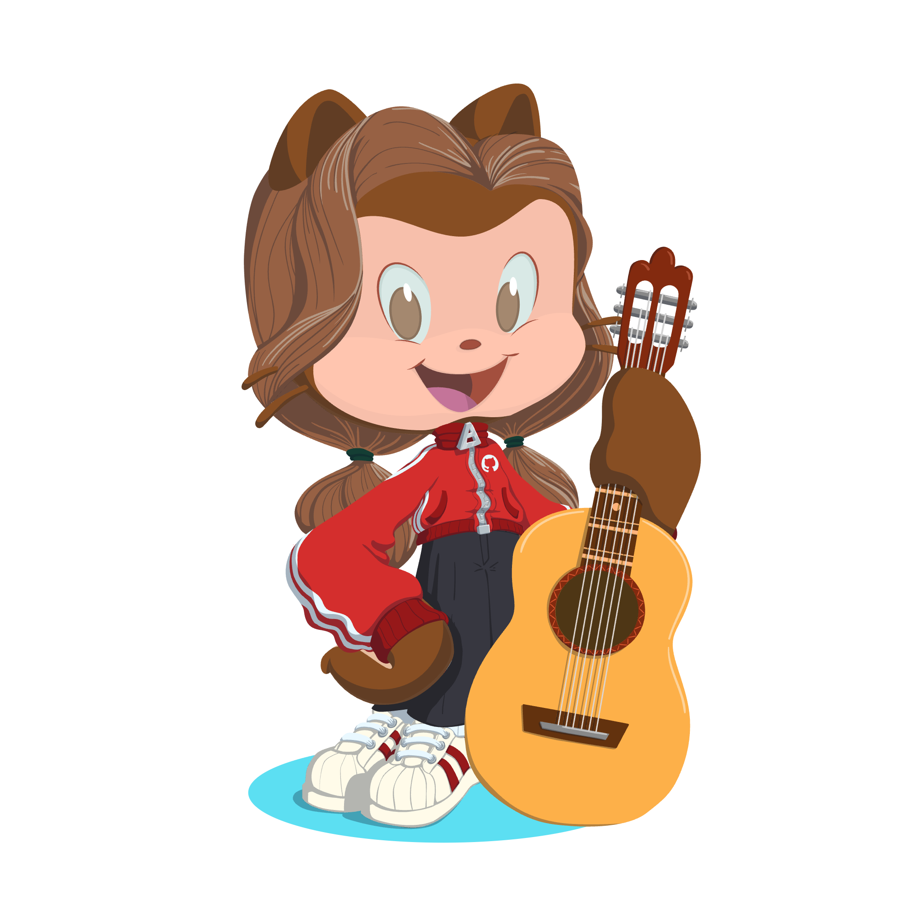

  <code>@bellanriz</code>

<h1 align="center">Hi, I'm Bella 🎀</h1>

  Just a chill girl turning curiosity into code. 
  A little creativity, a lot of learning, and one more commit before bed.

  

  
  

  

---

<table>
  <tr>
    <td width="35%" align="center" valign="middle">
      
    </td>
    <td width="65%" valign="middle">
      Hi there! 
      <h3>🌷 Welcome to my little dev corner</h3>
      
This is where I share my dev journey — the wins, the bugs, and everything in between. :D

      
🧠 Exploring <b>AI, machine learning & computer vision</b>

      
💻 Building my skills in <b>software & fullstack development</b>

      
🌱 Currently <b>upskilling, experimenting, and building</b>

      
🌙 Late-night coder, one small breakthrough at a time.

      
<code>learn → build → debug → celebrate → repeat</code>

    </td>
  </tr>
</table>

---

### 🧸 My developer toolbox

Languages, frameworks, and tools I use and explore.

#### Languages

  

#### AI & machine learning

  

#### Web & databases

  

#### Cloud & creative tools

  

---

### 💌 Let's build something lovely

Interested in **AI, software engineering, or fullstack development**? I'd love to connect!

<!-- Add your LinkedIn, portfolio, or professional email here. -->

   
  <i>Code. Learn. Build. Repeat. ♡</i> 
  Still learning. Still building. Still showing up.

  

